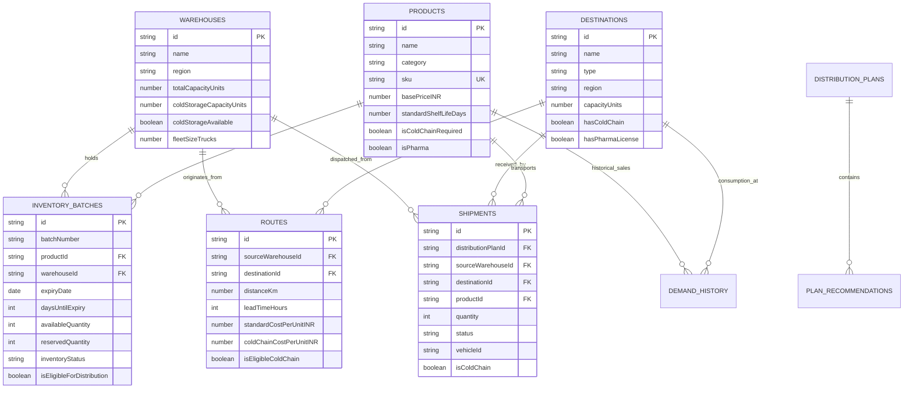

# 🗄️ SahiSupply AI — Database Architecture & Data Dictionary

This directory contains the database definitions, relational DDL, Mongoose schemas, and dataset exports for **SahiSupply AI**.

---

## 📁 Directory Structure

```
database/
├── README.md                      # Complete database documentation & schema reference
├── schema.sql                     # Full SQL DDL schema (PostgreSQL / SQLite / MySQL compatible)
└── collections/                   # Individual JSON collection dumps (mongoimport ready)
    ├── products.json              # 26 commercial FMCG & pharmaceutical products
    ├── warehouses.json            # 5 origin mega-hubs (Pune, Mumbai, Nashik, Kolhapur, Nagpur)
    ├── destinations.json          # 40 destination nodes (10 distributors + 30 retail/pharma)
    ├── inventoryBatches.json      # 390 inventory batches with FEFO & QA metadata
    ├── routes.json                # 200 route links with distance, cost & lead time
    ├── shipments.json             # Live shipments with vehicle telemetry
    ├── distributionPlans.json     # Saved optimization runs & allocations
    ├── demandHistory_sample.json  # Sample 90-day demand telemetry observations
    ├── settings.json              # Operational penalties & model assumptions
    └── auditLogs.json             # System audit & regulatory event trail
```

---

## 📊 Entity Relationship (ER) Model



---

## 🛠️ How to Import into MongoDB

### Option A: Using the Node.js Seeder Script (Recommended)
Make sure MongoDB is running, then run:

```bash
# Connects to mongodb://127.0.0.1:27017/sahisupply_ai (or custom MONGODB_URI)
MONGODB_URI="mongodb://localhost:27017/sahisupply_ai" node backend/src/scripts/seedMongo.js
```

### Option B: Using Native `mongoimport` CLI
```bash
cd database/collections

mongoimport --db sahisupply_ai --collection products --file products.json --jsonArray
mongoimport --db sahisupply_ai --collection warehouses --file warehouses.json --jsonArray
mongoimport --db sahisupply_ai --collection destinations --file destinations.json --jsonArray
mongoimport --db sahisupply_ai --collection inventoryBatches --file inventoryBatches.json --jsonArray
mongoimport --db sahisupply_ai --collection routes --file routes.json --jsonArray
mongoimport --db sahisupply_ai --collection shipments --file shipments.json --jsonArray
mongoimport --db sahisupply_ai --collection distributionPlans --file distributionPlans.json --jsonArray
```

---

## 🐘 How to Import into PostgreSQL or SQLite

```bash
# PostgreSQL
psql -U postgres -d sahisupply_ai -f database/schema.sql

# SQLite
sqlite3 sahisupply.db < database/schema.sql
```

---

## ⚡ Zero-Config File Database (Active Default)

The application includes a resilient storage engine in `backend/src/models/store.js` that persists all collections to `backend/data/sahisupply_db.json`.
- Zero database daemon setup needed to run the app.
- Full ACID-like reads and writes with JSON persistence.
- Auto-seeds on first launch if empty.
